<div align="center">

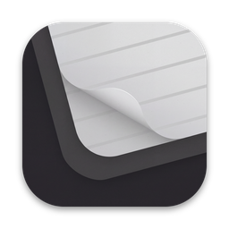

# Kraft

**Sticky notes for your whole life, on a kraft-paper board.**<br>
A native macOS sticky-notes planner for money people owe you, reminders, to-dos and quick notes — in English and Arabic.


-27A274)


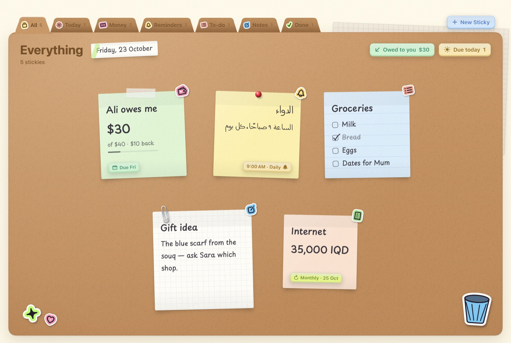

</div>

## Why Kraft

Life is messy. Who owes you money, what you owe, the medicine at 9, the groceries, the internet bill —
Kraft puts all of it on real-looking sticky notes, pinned to a kraft-paper folder. No accounts, no cloud,
no ads. It is built to feel like Apple made a stationery app: calm, tactile, precise.

<div align="center">
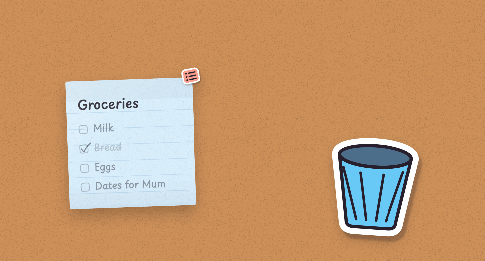
<br><sub>Drag a note and it crumples in your hand. Drop it in the bin — or press ⌘Z to un-crumple it.</sub>
</div>

## Features

- 💸 **Money stickies** — *Someone owes me* / *I owe someone*: person, amount in any currency (€40, £12, 200 SAR, ¥3,000…), due date, partial
  payments, what is left, and a **PAID** stamp that thumps on when it is settled.
- 💬 **"Remind them"** — a polite message in English or Arabic, ready to copy or open in WhatsApp.
- ⏰ **Reminders** — date, time, repeat (daily / weekly / monthly / yearly). One calm notification with
  **Done · Snooze 10 min · 1 h · Tomorrow**. Nothing pops up unasked.
- ✅ **To-do checklists**, 📝 **notes**, 🧾 **monthly bills**.
- ⌥ **Type a sentence, get a sticky** — `Ali owes me 40$ friday` or `ذكرني بالدواء الساعة ٩ كل يوم` fills in the
  person, amount, date, time and repeat, and shows you what it understood. Press **⌘N** in the app or
  **⌥Space from any app**.
- 🖥 **Desktop stickies** — drag a note out of the window and drop it on the desktop: it is pinned right there. It floats on top, never steals focus, places
  itself without overlapping, and **⌃⌥D** shows or hides them all. Board and desktop are the same note.
- 🎨 **Make every note yours** — paper colour (or any custom colour), handwriting, size, ink, ruling,
  tape / pin / paperclip, tilt.
- 🖱 **Right-click any note** — on the board or the desktop: open, done, pin, duplicate, copy text, paper colour,
  size, ruling, fastener, ink, throw away.
- 🗑 **Throw notes away** — drag a note: it crumples in your hand and flies into the waste bin. *Put Back* or ⌘Z.
- ↩️ **Undo everything**, **daily backups**, and a per-record merge format that is ready for iCloud Drive sync.
- 🌙 **Light and "night desk" dark** — the same kraft desk under a warm lamp. System / Light / Dark in Settings.
- 🔄 **Updates from GitHub** — Settings › Updates checks this repo's latest release, installs it and relaunches.
  It checks once a day on its own (you can turn that off), or use **Kraft › Check for Updates…**.
- 💱 **Every currency** — write `€40`, `£12.50`, `200 riyals` or `٥٠ درهم` and Kraft knows which one. Amounts without one use
  your default currency (Settings › Currency, which follows your Mac's region). Totals are kept per currency.
- 🌍 **Full English + Arabic UI** with right-to-left layout and a Western (123) / Arabic (١٢٣) digits option.
  Each note picks its handwriting and direction from its own text.

## Screenshots

| Write on the paper | Type a sentence, get a sticky |
|---|---|
| 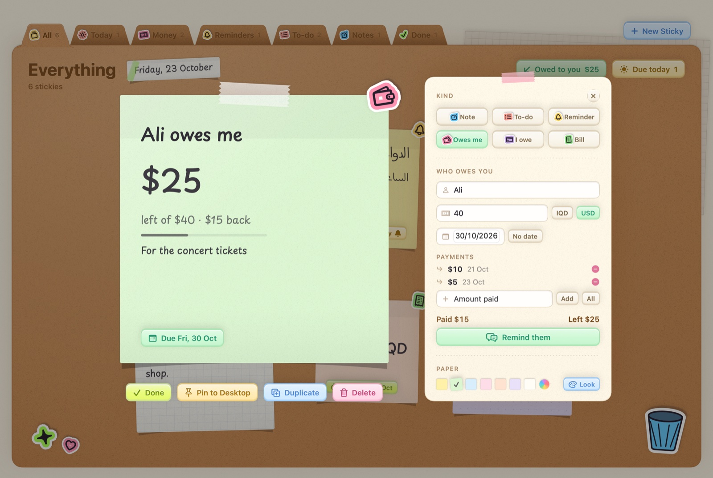 | 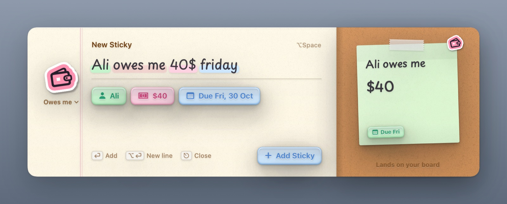 |

| Arabic, right-to-left | «ذكرني بالدواء الساعة ٩ كل يوم» |
|---|---|
| 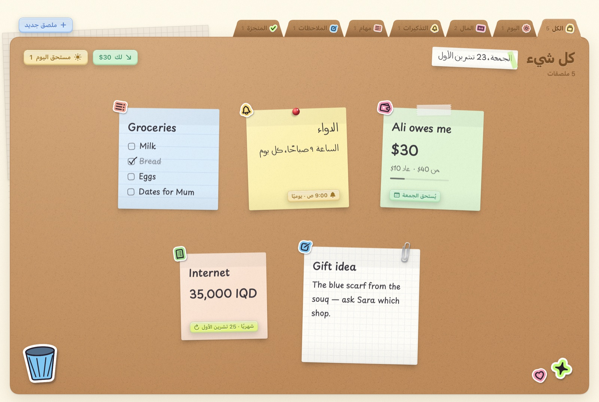 | 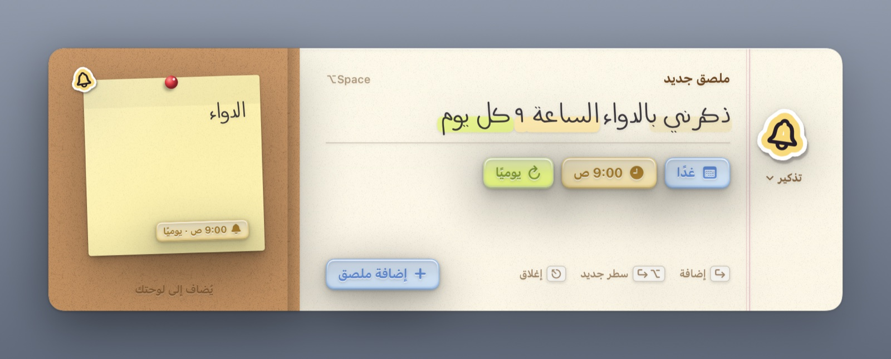 |

| Stickies on your desktop | Make it yours |
|---|---|
| 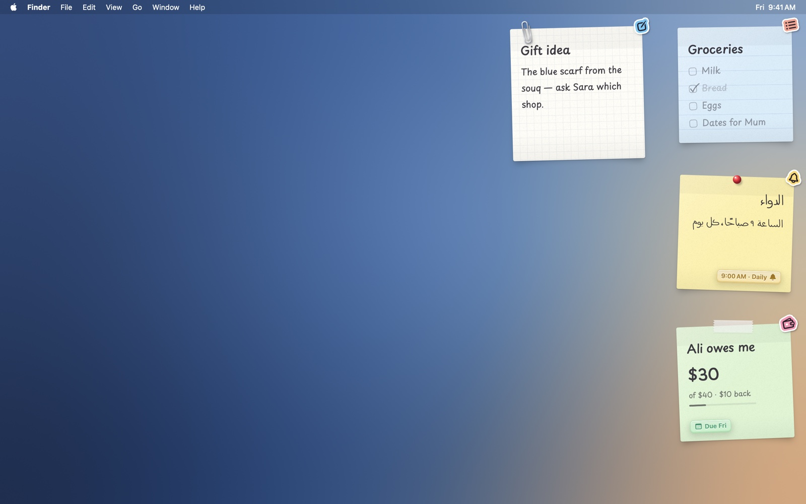 | 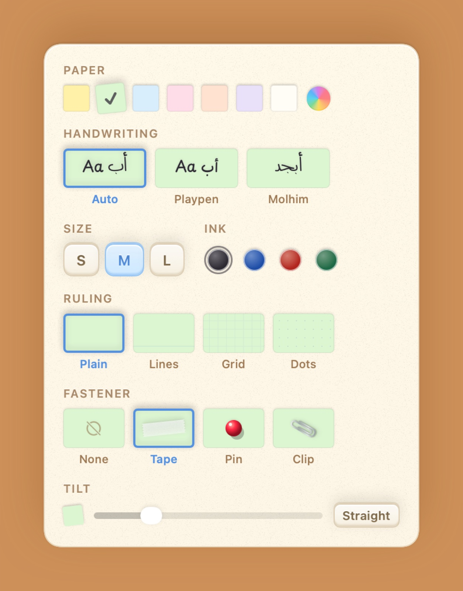 |

| Night desk (dark) | Dark, in Arabic |
|---|---|
| 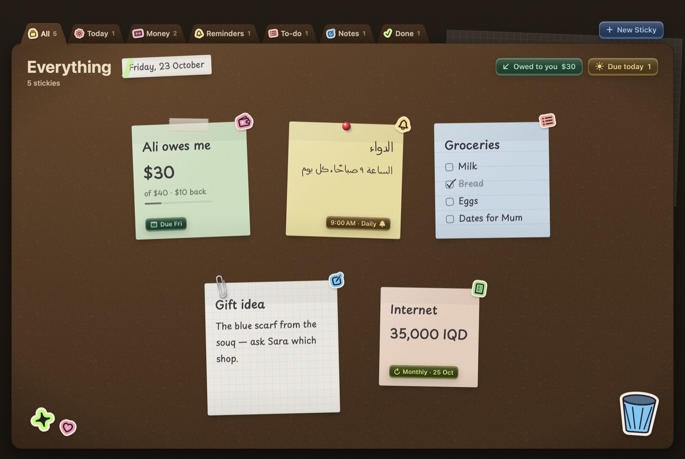 | 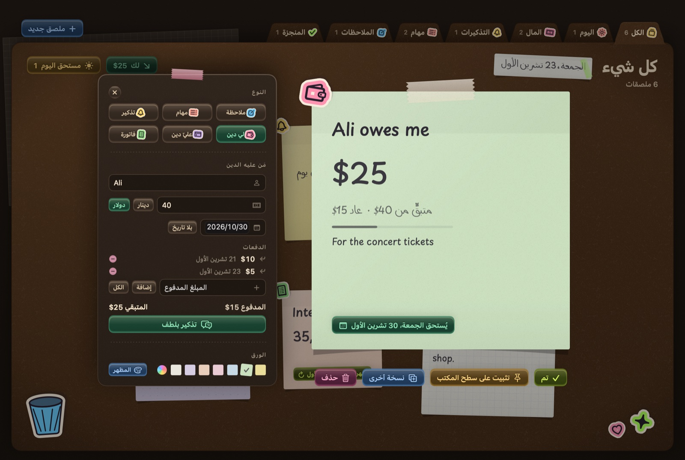 |

| A polite reminder, in Arabic | Settings and updates |
|---|---|
| 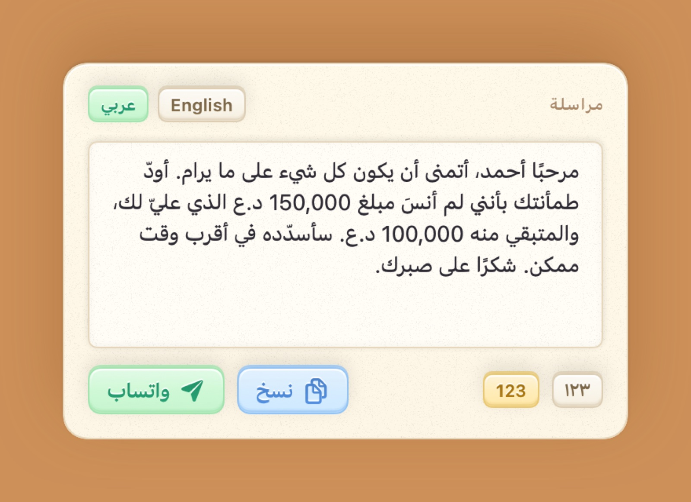 | 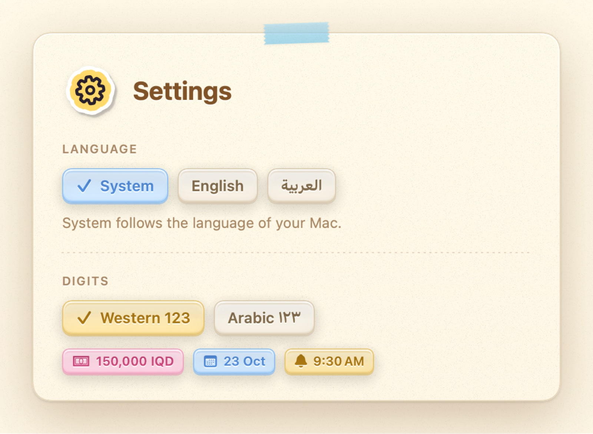 |

<div align="center">
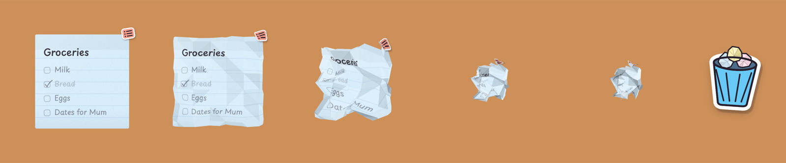
</div>

## Design language — "Apple-premium stationery"

Warm off-white page, a kraft-paper folder with tabs for navigation, glossy embossed pastel tags for buttons and
filters, die-cut sticker icons with a white outline and an offset shadow, and sticky notes with an adhesive band,
paper grain, a curling corner, washi tape and push pins. UI text is SF Pro / SF Arabic; only the paper uses
handwriting. Every colour, size and shadow is specified in **[DESIGN.md](DESIGN.md)**.

## Install

Kraft needs **macOS 26** or later.

**Download:** grab `Kraft.zip` from [Releases](../../releases), unzip it and drag **Kraft** to Applications.
The build is ad-hoc signed (not notarized), so the first time, right-click Kraft → **Open**, or run:

```sh
xattr -dr com.apple.quarantine /Applications/Kraft.app
```

**Build from source** — only the Command Line Tools are needed (no Xcode):

```sh
git clone https://github.com/hamdalaa/kraft.git && cd kraft
./scripts/bundle.sh          # → build/Kraft.app
./scripts/test.sh            # Swift Testing, 180+ tests
open build/Kraft.app
```

## Privacy

- **100 % local.** Kraft makes no network requests. No accounts, analytics or tracking.
- Notes live in `~/Library/Application Support/Kraft/stickies.json`, with 30 daily backups next to it.
  Files are owner-only (`0600`), folders `0700`.
- Notification permission is only requested once you create your first reminder.

## Fonts

- **Playpen Sans Arabic** (SIL Open Font License, included) — handwriting on English *and* Arabic notes.
- Optional: an Arabic handwriting font of your own. Put a font named **Molhim** at
  `Resources/PrivateFonts/Molhim.ttf` before building and Arabic notes use it automatically. It is not included
  because its licence does not allow redistribution.

## Architecture

```
Sources/
  KraftCore/      models, persistence + merge, natural-language parser (EN/AR), scheduling,
                  desktop layout, messages, formatting — pure Swift, fully unit-tested
  Kraft/          SwiftUI app: Board · Editor · QuickAdd · Desktop · Notifications · Settings · Design kit
Tests/            Swift Testing
scripts/          bundle.sh · test.sh · snapshots.sh · make-icon.sh
```

`./scripts/snapshots.sh` renders every screen offscreen in English and Arabic (`snapshots/en`, `snapshots/ar`) —
plus `en-dark` / `ar-dark` — handy for visual review without clicking through the app.

## Roadmap

- iPhone companion app syncing through iCloud Drive

## License

[MIT](LICENSE). Playpen Sans Arabic is under the [SIL Open Font License](Resources/Fonts/OFL-PlaypenSansArabic.txt).
